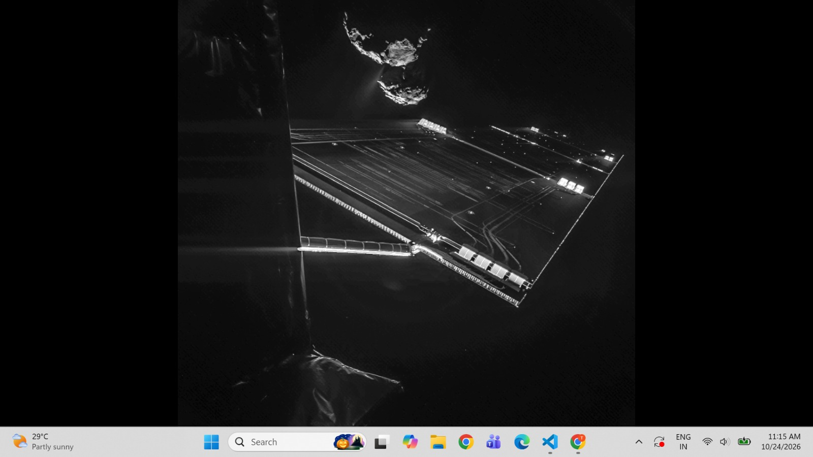
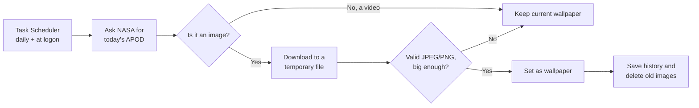

<div align="center">


<br/>


<br/>



<sub><b>Rosetta's Selfie</b> (APOD, 24 Oct 2026). Image credit: ESA/Rosetta/Philae/CIVA. Shown here as set by Daily Cosmos.</sub>

</div>

---

## 🌌 What if your office had a window to the universe?

Your office has a window, maybe. Or it has a wall, a humming air vent, and a monitor that has seen too many spreadsheets.

Now imagine this. You open your laptop on Monday morning, and your desktop is a spacecraft taking a selfie beside a comet, 472 million kilometres from home. On Tuesday it's a galaxy glowing over a desert horizon. On Wednesday, something you've never seen before. Nobody picked these for you. You didn't click anything. The universe just showed up.

**Daily Cosmos** makes that happen. Every day it asks NASA for the *Astronomy Picture of the Day*, checks that the image is genuine and good enough, and sets it as your Windows wallpaper. If anything goes wrong (no Wi-Fi, a broken download, a video day), it quietly keeps your current wallpaper and tries again later.

A small daily reminder that there is a lot of universe out there, and your Tuesday meeting is a tiny part of it. 🔭

---
<div align="center">
  
  <br/>
  <sub>Your commute to the cosmos. GIF via <a href="https://giphy.com/gifs/ab0nvsRq4Fyak">GIPHY</a>.</sub>
</div>

## ✨ Features

- 🛰️ **Fetches today's APOD** (title, date, credit, image) from NASA's current APOD API. No API key needed.
- 🔍 **Validates every download.** It checks the file type, size, and that the image fully decodes, and only accepts JPEG or PNG at 800×600 or larger.
- 🛡️ **Fails safely.** Network errors, API errors, videos, and corrupt images never touch your wallpaper.
- 🖼️ **Sets the Windows wallpaper** through the Windows API, with a configurable fit style.
- 🗂️ **Keeps a history** of every picture in `data/history.json` (title, date, credit, link).
- 🧹 **Cleans up after itself** by deleting images older than 7 days (configurable).
- 📜 **Logs everything** to the screen and to a rotating log file.
- ⏰ **Runs automatically** with Windows Task Scheduler: daily, at logon, with catch-up and retries.
- 🔐 **No secrets.** No API key, no account, no telemetry.

---

## 🔭 How it works



The only sites it contacts are `science.nasa.gov` (metadata) and `assets.science.nasa.gov` (the image).

---

## 📋 Requirements

| Requirement | Details |
|---|---|
| **OS** | Windows 10 or 11. It uses Windows-only wallpaper and Task Scheduler features. |
| **Python** | Developed and tested on **3.14.4**. The code uses `X \| None` type syntax, so it needs Python 3.10 or newer. Other versions are untested. |
| **Packages** | [`requests`](https://pypi.org/project/requests/) and [`Pillow`](https://pypi.org/project/pillow/) (installed from `requirements.txt`) |
| **Internet** | Needed only during the daily update |
| **Git** | Optional, only for cloning |

---

## 🚀 Quick start

Open **PowerShell** and run these steps in order.

### 1. Get the code

```powershell
git clone https://github.com/thejaswini-peddiraju/daily-cosmos.git
cd daily-cosmos
```

### 2. Create a virtual environment and install dependencies

```powershell
python -m venv .venv
.\.venv\Scripts\Activate.ps1
python -m pip install --upgrade pip
python -m pip install -r requirements.txt
```

> If PowerShell says *"running scripts is disabled on this system"*, run this once and try again:
> `Set-ExecutionPolicy -Scope CurrentUser -ExecutionPolicy RemoteSigned`

### 3. Run it once by hand

```powershell
python -m daily_cosmos
```

Your wallpaper should change within a few seconds, and you'll see output like this (values depend on the day):

```
<date time> | INFO    | Starting update
<date time> | INFO    | APOD <date>: <title> (image)
<date time> | INFO    | Credit: <name>
<date time> | INFO    | Downloaded: ...\data\images\<date>_<title>.png (<width>x<height>)
<date time> | INFO    | Wallpaper set
<date time> | INFO    | History saved. Cleanup removed 0 image(s) older than 7 days.
```

### 4. Make it automatic

```powershell
.\scripts\register_task.ps1
```

This creates a Task Scheduler task named **DailyCosmos**. Choose a different time like this:

```powershell
.\scripts\register_task.ps1 -Time "08:30"
```

If you see *Access is denied*, open PowerShell **as administrator**, `cd` into the project folder, and run the script again.

---

## ⏰ Scheduling details

| Situation | What happens |
|---|---|
| Daily at the chosen time (default **11:00**) | Updates the wallpaper |
| Laptop was off or asleep at that time | Catches up as soon as it's available |
| You log in | Runs about a minute after logon |
| Wi-Fi isn't ready yet | Retries up to 3 times, 5 minutes apart |
| On battery | Still runs (it takes a few seconds) |
| Anything takes over 10 minutes | The run is stopped |
| You're logged out | Doesn't run. Windows can only change your wallpaper from your own session. |

It does not wake a sleeping laptop. It runs when you next wake or start it.

**Turn it off or on:**

```powershell
Disable-ScheduledTask -TaskName DailyCosmos                       # pause
Enable-ScheduledTask  -TaskName DailyCosmos                       # resume
Unregister-ScheduledTask -TaskName DailyCosmos -Confirm:$false    # remove completely
```

Turning it off never changes your current wallpaper. Pick a new one any time in *Settings → Personalization → Background*.

---

## ⚙️ Configuration

| What | Where | Default |
|---|---|---|
| Days to keep images | `retention_days` in `daily_cosmos/config.py` | `7` |
| Where data and logs are stored | `data_dir` and `logs_dir` in `daily_cosmos/config.py` | `data/`, `logs/` |
| Network timeout | `request_timeout` in `daily_cosmos/config.py` | `15` seconds |
| Wallpaper style | `style` default in `set_wallpaper()` in `daily_cosmos/wallpaper.py` | `"fit"` |
| Daily run time | `-Time` argument of `register_task.ps1` | `11:00` |

Wallpaper styles: `fill` (crops edges to fill the screen), `fit` (whole picture, bars if needed), `stretch`, `tile`, `center`, `span`.

---

## 📁 Project structure

```
daily-cosmos/
├── daily_cosmos/
│   ├── __main__.py        # entry point: python -m daily_cosmos
│   ├── apod_client.py     # talks to NASA, parses the response
│   ├── downloader.py      # safe download and image validation
│   ├── wallpaper.py       # sets the Windows wallpaper
│   ├── history.py         # history.json and old-image cleanup
│   ├── logging_setup.py   # screen + rotating log file
│   └── config.py          # all settings in one place
├── scripts/
│   └── register_task.ps1  # creates the Task Scheduler task
├── docs/                  # README images
├── data/                  # images + history (created at runtime, Git-ignored)
├── logs/                  # log files (created at runtime, Git-ignored)
├── requirements.txt
└── README.md
```

---

## 🧰 Troubleshooting

**Where are the logs?** In `logs\daily_cosmos.log`. Scheduled runs have no window, so errors only appear there.

```powershell
Get-Content logs\daily_cosmos.log -Tail 20
```

| Problem | Likely fix |
|---|---|
| `No module named daily_cosmos` | Run commands from the project folder. |
| `No module named requests` or `PIL` | Activate the venv and run `pip install -r requirements.txt`. |
| `Could not reach NASA` | Check your internet, VPN, or firewall. The wallpaper stays unchanged. |
| `Entry is a video` | Some days feature a video. The wallpaper is deliberately left unchanged. |
| Black bars around the picture | The picture's shape doesn't match your screen. Try `style="fill"`. |
| Task didn't run | `Get-ScheduledTaskInfo -TaskName DailyCosmos` shows the last run time and result. `0` means success. |

---

## ❓ FAQ

**Does it need an API key?** No. It uses NASA Science's APOD endpoint, which needs no key, so there are no secrets to protect.

**Will it eat my storage or battery?** Not noticeably. It runs for a few seconds a day, nothing stays in memory, and old images are deleted after 7 days.

**Does it overwrite a wallpaper I picked myself?** Yes, the next time it runs. Pause it with `Disable-ScheduledTask` if you want to keep your own for a while.

**What if NASA changes its API again?** The app will fail cleanly, log the reason, and leave your wallpaper alone.

---

## 🗺️ Roadmap

- [ ] Automated test suite
- [ ] Wallpaper style as a setting in `config.py`
- [ ] Use a video day's still frame (optional)
- [ ] Gallery of favourite pictures

---

## 🖼️ Gallery

<!-- Add more screenshots here, for example:

Always add the picture title and credit under each image. -->

---

## 🙏 Credits

- Pictures come from NASA's **[Astronomy Picture of the Day](https://apod.nasa.gov/)**. Each image belongs to its credited creator or agency, and the credit is recorded in `data/history.json` for every download.
- The screenshot above shows *Rosetta's Selfie*, image credit: ESA/Rosetta/Philae/CIVA.
- This project is an independent hobby project and is **not affiliated with or endorsed by NASA or ESA**. Daily Cosmos does not redistribute images. Everything it downloads stays on your own computer.


</div>


<sub>GIF by <a href="https://giphy.com/channel/Montyland_/">Montyland</a> via <a href="https://giphy.com/gifs/dancing-cat-dance-montyland-AQG7LmOZdceDZnj4dX">GIPHY</a>.</sub>

*Look up. 🌠*
